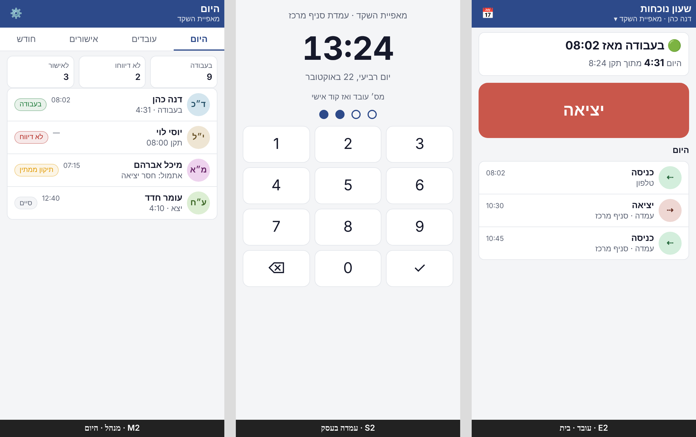

# שעון נוכחות — גרסה 1: מסכים ונתונים
עודכן: 2026-10-22. ממשיך את ההחלטות ב-`../SPEC.md` (גרסה 1 = ליבה). **הצעה לאישור** — שום דבר כאן עוד לא מומש.
השאלות שנשארו פתוחות לגרסה 1 — בסוף, בפרק "לאישור לפני פיתוח".

## 1. מה בגרסה 1, ומה לא
| בגרסה 1 | לא בגרסה 1 |
| --- | --- |
| פתיחת חברה, צוות ניהול, עובדים, שעות תקן בגרסאות | שכר, ממשק לשכר, פענוח חוזים |
| כניסה ויציאה מהטלפון | מיקום, צילום, QR |
| עמדה בעסק עם קוד אישי | חישוב שעות נוספות לפי דין, חגים, חופשות, מחלה |
| היסטוריה, בקשת תיקון ואישורה, יומן שינויים | מכסות, ניסיון ותשלום |
| אישור חודשי בשלבים לכל חברה, נעילה, ייצוא CSV והדפסה | שליחת תלושים |

**"מעל התקן"** בגרסה 1 הוא רק ההפרש בין השעות שדווחו לשעות התקן. זה **לא** חישוב שעות נוספות לפי דין, והמסך אומר את זה במפורש.

## 2. שלושה סוגי כניסה — שלוש כתובות
| מי | כתובת | שער | זהות |
| --- | --- | --- | --- |
| בעלים, מנהל, מנהלת שכר | `time-clock/` (הדף הראשי) | מאחורי השער | `$_SERVER['PLATFORM_USER']`. החשבון באפליקציה מקושר ל-`sub` ונפתח מיד בכניסה הראשונה |
| עובד בטלפון | `time-clock/e/` | `public` | קישור הזמנה אישי, קוד אישי ועוגייה של המכשיר |
| עמדה בעסק | `time-clock/s/` | `public` | אסימון עמדה (נוצר בהצמדה), ובכל דיווח הקוד של העובד |

- כל מי שמחובר לפלטפורמה ויש לו הרשאה לשעון הנוכחות יכול לפתוח חברה. הוא נהיה הבעלים שלה.
- אדם אחד יכול להיות עובד בחברה אחת ומנהל בחברה אחרת. מנהל שהוא גם עובד מדווח מ-`e/` כמו כל עובד, ואפשר לקשר את שני התפקידים לאותו אדם.
- עוגייה בשם משלה: `tc_session`, ובעמדה `tc_station`. בלי `require` מחוץ לתיקייה.

**ב-`app.json`** (בשלב שבו הכתובות האלה ייבנו):
```json
"public": ["e/**", "s/**", "assets/**", "api.php?action=emp_activate|emp_login|emp_state|emp_punch|emp_month|emp_correct|emp_approve|station_pair|station_state|station_punch"]
```

## 3. המסכים — עובד (`e/`)


*שלד להמחשה בלבד (390px): מימין עובד, באמצע עמדה, משמאל מנהל.*

כל המסכים בנויים בשפת העיצוב של מנהל הפרויקטים (הסקיל phone-first-design): טלפון קודם, שורה אחת, כפתור עיקרי אחד.

**E1 · הפעלה (מהקישור).**
- "שלום דנה — שעון הנוכחות של ‹חברה›".
- בחירת קוד אישי (4 ספרות, פעמיים). העובד ישתמש בו גם בעמדה.
- הקישור חד-פעמי ותקף 7 ימים. אחרי ההפעלה המכשיר זוכר את העובד (עוגייה ל-180 יום).

**E2 · בית.**
- כרטיס מצב: "בעבודה מאז 08:02" או "לא בעבודה", וסה״כ היום.
- כפתור ענק אחד: **כניסה** או **יציאה**, לפי המצב.
- מתחתיו הדיווחים של היום, כשורות.
- למי שעובד בכמה חברות: בורר חברה בכותרת.

**E3 · החודש שלי.**
- בורר חודש ‹ › וכרטיס סיכום: ימים, שעות, תקן, הפרש.
- שורה לכל יום: תאריך · 08:02–16:40 · 8:38, ותגיות: `חסר יציאה` · `תוקן` · `ממתין לאישור`.
- לחיצה על יום פותחת גיליון (E4).

**E4 · יום ובקשת תיקון.**
- הדיווחים של היום.
- "בקשת תיקון": בורר מקטעים (הוספת דיווח · שינוי שעה · מחיקה), שעה, וסיבה (חובה).
- הבקשה מוצגת כ"ממתינה" עד שהמנהל מחליט.

**E5 · אישור החודש.**
- כשהחודש נפתח לאישור, מופיע כרטיס בראש E2: "חודש אוקטובר מוכן לאישורך".
- בכרטיס: סיכום ואז **אישור החודש**. אחרי האישור מוצגים השלבים שנותרו (מנהל ✓ · מנהלת שכר …).

## 4. המסכים — עמדה (`s/`)
**S1 · הצמדה.**
- המנהל לוחץ "עמדה חדשה" בהגדרות ומקבל קוד הצמדה בן 6 ספרות (תקף 10 דקות).
- בטאבלט פותחים את `s/` ומקלידים את הקוד, והמכשיר נהיה עמדה של החברה (ושל הסניף, אם יש).
- המנהל יכול לבטל עמדה בכל רגע.

**S2 · מקלדת.**
- שעון גדול, שם החברה והעמדה, ומקלדת מספרים.
- העובד מקיש את הזיהוי שלו (ראו שאלה 1 בסוף), ואז מוצג "שלום דנה". הפעולה הצפויה (כניסה או יציאה) מודגשת, והשנייה זמינה.
- אחרי הלחיצה: אישור ירוק לשתי שניות, וחזרה למקלדת. בעמדה לא מוצג שום מידע אישי מעבר לשם.
- אחרי 5 קודים שגויים — המתנה של דקה.

## 5. המסכים — ניהול (`time-clock/`)
| מסך | מה רואים | הפעולה העיקרית |
| --- | --- | --- |
| **M1 · פתיחת חברה** | שם, ח.פ. (רשות), תקן ברירת מחדל: 5 או 6 ימים, שעות ליום | "פתיחת החברה" |
| **M2 · היום** | כרטיס סיכום: בעבודה עכשיו · לא דיווחו · ממתינים לאישור. מתחת: שורת מצב לכל עובד | — |
| **M3 · עובדים** | שורות: שם · תפקיד · מצב הזמנה | "+ עובד" (גיליון: שם, טלפון, מייל, מס׳ עובד, תאריך התחלה, תקן) ← קישור הזמנה עם "שליחה בוואטסאפ" ו"העתקה" |
| **M4 · כרטיס עובד** | לשוניות: נוכחות (החודש, כמו E3) · תנאים (גרסאות עם תאריך תחולה) · פרטים | ✏️ על כל דיווח = תיקון של מנהל (עם סיבה, נרשם ביומן) |
| **M5 · אישורים** | לשוניות עם מונה: תיקונים · חודש. תיקון = שורה: מי · ישן ← חדש · סיבה | ✓ / ✕ (דחייה עם הערה) |
| **M6 · חודש** | בורר חודש. שורה לכל עובד עם השלבים (עובד ✓ · מנהל … · שכר …) | "פתיחה לאישור", "נעילה"; ⬇️ CSV, 🖨️ הדפסה |
| **M7 · הגדרות** | פרטי החברה · צוות ניהול ותפקידים · שלבי אישור (רשימה מסודרת, גרירה) · סניפים · עמדות | — |

**תפקידים בגרסה 1:**
- **בעלים** — הכול.
- **מנהל** — עובדים, תיקונים ואישור חודשי.
- **מנהלת שכר** — צפייה, אישור חודשי וייצוא.
- **עובד** — רק הנתונים של עצמו.

מנהל רואה את כל עובדי החברה. שיוך עובד למנהל מסוים — בהמשך.

**שלבי האישור (ברירת מחדל):** עובד ← מנהל. החברה יכולה להוסיף שלבים: מנהלת שכר, מורשה חתימה (אישור מתועד; "חתימה" במובן אחר נשארה שאלה פתוחה ב-SPEC). שלב מוגדר לפי **תפקיד** — כל מי שבתפקיד יכול לאשר.

## 6. כללי החישוב בגרסה 1
- **שמירה וזמן.** הזמן נשמר ב-UTC ומוצג לפי `Asia/Jerusalem`, כך ששעון קיץ לא שובר חישובים.
- **משמרת שחוצה חצות** שייכת ליום שבו התחילה.
- **סה״כ יומי** הוא סכום הזוגות כניסה ← יציאה.
- **הפסקה** מדווחת כיציאה וכניסה. אין סוג "הפסקה" נפרד בגרסה 1.
- **דיווח חסר.** כניסה בלי יציאה מסומנת `חסר יציאה` ולא נספרת. התיקון עובר בבקשת תיקון.
- **שני דיווחים כפולים.** דיווח זהה לקודם בתוך דקה (כניסה אחרי כניסה) נחסם עם הודעה.
- **עיגול.** אין עיגול — דקות מדויקות.
- **דיווח מקורי** אף פעם לא נמחק ולא משתנה. תיקון הוא רשומה נפרדת, והמסך מראה את התוצאה עם `תוקן`.
- **חודש נעול** לא מקבל תיקונים. פתיחה מחדש (בעלים בלבד, עם סיבה) מבטלת את האישורים של אותו חודש ונרשמת ביומן.

## 7. הנתונים
מסד SQLite אחד: `time-clock/data/time-clock.sqlite`. בפריסה צריך להחריג: `time-clock/data/*.sqlite*` ו-`time-clock/data/secret.key`. ההחרגה נוספת ל-`deploy.yml` **באותו PR שכותב לראשונה**.

| טבלה | שדות עיקריים | הערה |
| --- | --- | --- |
| `people` | id, name, phone, email, platform_sub? | אדם אחד בכל החברות |
| `companies` | id, name, tax_id?, tz, created_by, created_at | |
| `members` | id, company_id, person_id, role, employee_no, start_date, end_date, status, pin_hash | חברוּת = אדם בחברה. הקוד מגובב (`password_hash`) |
| `work_terms` | id, member_id, effective_from, days_per_week (5/6), daily_minutes, pay_type (חודשי/שעתי, לתיעוד בלבד) | גרסאות. לא דורסים |
| `sites` | id, company_id, name | אופציונלי |
| `stations` | id, company_id, site_id?, name, token_hash, paired_by, last_seen, revoked_at | |
| `invites` | id, member_id, token_hash, expires_at, used_at | |
| `devices` | id, person_id, token_hash, created_at, last_seen, revoked_at | העוגייה של העובד |
| `punches` | id, member_id, kind (in/out), at_utc, source (phone/station/manager), station_id?, device_id?, created_at | **לא משתנה אף פעם** |
| `corrections` | id, member_id, op (add/move/void), punch_id?, new_at?, new_kind?, reason, requested_by, status, decided_by, decided_at, note | |
| `approval_steps` | id, company_id, ord, role, label | ההגדרה של החברה |
| `periods` | id, company_id, month (YYYY-MM), status (open/review/locked), locked_by, locked_at | |
| `period_signoffs` | id, period_id, member_id, step_ord, by_member, at, note | אישור של עובד בחודש בשלב |
| `audit` | id, company_id, actor, action, entity, before, after, at | כל שינוי |

**הפרדה בין חברות:** כל שאילתה עוברת דרך `company_id` של החברוּת המחוברת. אין API שמקבל `company_id` מהדפדפן בלי לבדוק חברוּת.

**ייצוא CSV** (UTF-8 עם BOM, נפתח באקסל): עובד · מס׳ עובד · תאריך · כניסה · יציאה · סה״כ · תקן · הפרש · תוקן · הערה. ה-CSV הוא גם המבנה הבסיסי לממשק השכר בעתיד.

## 8. שלבי הפיתוח — כל שלב PR, מיזוג ואימות פריסה
1. **יסוד:**
   - מסד, `--exclude` ב-`deploy.yml` וכניסת מנהל דרך `PLATFORM_USER`.
   - M1 (פתיחת חברה) ו-M7 (פרטי חברה וצוות).
2. **עובדים:** M3 ו-M4 (פרטים ותנאים), קישור הזמנה, E1 (הפעלה וקוד).
3. **דיווח מהטלפון:** E2, E3 ו-M2.
4. **עמדה:** S1, S2 והגדרת העמדות ב-M7.
5. **תיקונים:** E4, M5 והיומן.
6. **חודש:** שלבי אישור ב-M7, E5, M6, נעילה, CSV והדפסה.
7. **ניקוי:**
   - דף הפתיחה הישן יוצא.
   - ב-`app.json`: תיאור חדש, וקטגוריה במקום `dev`.

אחרי כל שלב: בדיקה בטלפון (390px ו-320px, מצב כהה) וצילום מסך לבעל המערכת. הכתובות הציבוריות נבדקות גם בחלון גלישה בסתר.

## 9. לאישור לפני פיתוח
1. **זיהוי בעמדה.**
   - מומלץ: מס׳ עובד וקוד בן 4 ספרות.
   - חלופה: קוד בלבד, ייחודי בחברה (6 ספרות). מהיר יותר, אבל חלש יותר.
2. **שליחת קישור ההזמנה.**
   - מומלץ: המנהל שולח בוואטסאפ או מעתיק.
   - חלופה: SMS אוטומטי (עולה כסף, ודורש ספק).
3. **מכשיר חדש לעובד.**
   - מומלץ: המנהל שולח קישור חדש.
   - חלופה: "שלחו לי קישור" למייל של העובד.
4. **סניפים בגרסה 1.**
   - מומלץ: כן, שם בלבד, כדי לשייך עמדות.
   - חלופה: בלי סניפים עד שיידרש.
