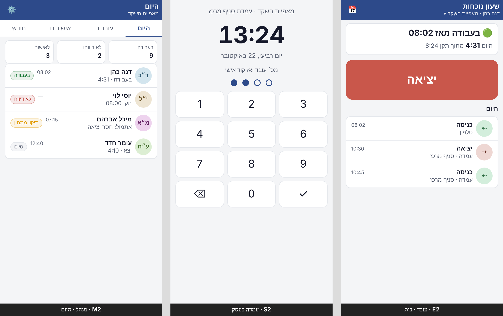

# שעון נוכחות — גרסה 1: מסכים ונתונים
עודכן: 2026-10-22. ממשיך את ההחלטות ב-`../SPEC.md` (גרסה 1 = ליבה). **גרסה 1 הושלמה (2026-10-23).** המסמך נשאר כאפיון המקורי; הנתונים המדויקים — `lib/db.php`, ומה שנוסף אחרי כך — `v2-overtime-holidays.md` ו-`v3-absences.md`.

## 1. מה בגרסה 1, ומה לא
| בגרסה 1 | לא בגרסה 1 |
| --- | --- |
| פתיחת חברה, צוות ניהול, עובדים, שעות תקן בגרסאות | שכר, ממשק לשכר, פענוח חוזים |
| כניסה ויציאה מהטלפון | מיקום, צילום, QR |
| עמדה בעסק עם קוד אישי | חישוב שעות נוספות לפי דין, חגים, חופשות, מחלה |
| היסטוריה, בקשת תיקון ואישורה, יומן שינויים | מכסות, ניסיון ותשלום |
| אישור חודשי בשלבים לכל חברה, נעילה, ייצוא CSV והדפסה | שליחת תלושים |

**"מעל התקן"** בגרסה 1 הוא רק ההפרש בין השעות שדווחו לשעות התקן. זה **לא** חישוב שעות נוספות לפי דין, והמסך אומר את זה במפורש.

## 2. שלושה סוגי כניסה — שלוש כתובות
| מי | כתובת | שער | זהות |
| --- | --- | --- | --- |
| בעלים, מנהל, מנהלת שכר | `time-clock/` (הדף הראשי) | מאחורי השער | `$_SERVER['PLATFORM_USER']`. החשבון באפליקציה מקושר ל-`sub` ונפתח מיד בכניסה הראשונה |
| עובד בטלפון | `time-clock/e/` | `public` | קישור הזמנה אישי, קוד אישי ועוגייה של המכשיר |
| עמדה בעסק | `time-clock/s/` | `public` | אסימון עמדה (נוצר בהצמדה), ובכל דיווח הקוד של העובד |

- כל מי שמחובר לפלטפורמה ויש לו הרשאה לשעון הנוכחות יכול לפתוח חברה. הוא נהיה הבעלים שלה.
- אדם אחד יכול להיות עובד בחברה אחת ומנהל בחברה אחרת. מנהל שהוא גם עובד מדווח מ-`e/` כמו כל עובד, ואפשר לקשר את שני התפקידים לאותו אדם.
- עוגייה בשם משלה: `tc_session`, ובעמדה `tc_station`. בלי `require` מחוץ לתיקייה.

**ב-`app.json`** (הרשימה המלאה והמעודכנת שם; כאן הרשימה של גרסה 1 בלבד):
```json
"public": ["e/**", "s/**", "assets/**", "api.php?action=emp_invite_info|emp_activate|emp_state|emp_punch|emp_month|emp_correct|emp_correct_cancel|emp_corrections|emp_approve|station_pair|station_state|station_check|station_punch"]
```

## 3. המסכים — עובד (`e/`)


*שלד להמחשה בלבד (390px): מימין עובד, באמצע עמדה, משמאל מנהל.*

כל המסכים בנויים בשפת העיצוב של מנהל הפרויקטים (הסקיל phone-first-design): טלפון קודם, שורה אחת, כפתור עיקרי אחד.

**E1 · הפעלה (מהקישור).**
- "שלום דנה — שעון הנוכחות של ‹חברה›".
- בחירת קוד אישי (4 ספרות, פעמיים). העובד ישתמש בו גם בעמדה.
- הקישור חד-פעמי ותקף 7 ימים. אחרי ההפעלה המכשיר זוכר את העובד (עוגייה ל-180 יום).

**E2 · בית.**
- כרטיס מצב: "בעבודה מאז 08:02" או "לא בעבודה", וסה״כ היום.
- כפתור ענק אחד: **כניסה** או **יציאה**, לפי המצב.
- מתחתיו הדיווחים של היום, כשורות.
- למי שעובד בכמה חברות: בורר חברה בכותרת.

**E3 · החודש שלי.**
- בורר חודש ‹ › וכרטיס סיכום: ימים, שעות, תקן, הפרש.
- שורה לכל יום: תאריך · 08:02–16:40 · 8:38, ותגיות: `חסר יציאה` · `תוקן` · `ממתין לאישור`.
- לחיצה על יום פותחת גיליון (E4).

**E4 · יום ובקשת תיקון.**
- הדיווחים של היום.
- "בקשת תיקון": בורר מקטעים (הוספת דיווח · שינוי שעה · מחיקה), שעה, וסיבה (חובה).
- הבקשה מוצגת כ"ממתינה" עד שהמנהל מחליט.

**E5 · אישור החודש.**
- כשהחודש נפתח לאישור, מופיע כרטיס בראש E2: "חודש אוקטובר מוכן לאישורך".
- בכרטיס: סיכום ואז **אישור החודש**. אחרי האישור מוצגים השלבים שנותרו (מנהל ✓ · מנהלת שכר …).

## 4. המסכים — עמדה (`s/`)
**S1 · הצמדה.**
- המנהל לוחץ "עמדה חדשה" בהגדרות ומקבל קוד הצמדה בן 6 ספרות (תקף 10 דקות).
- בטאבלט פותחים את `s/` ומקלידים את הקוד, והמכשיר נהיה עמדה של החברה (ושל הסניף, אם יש).
- המנהל יכול לבטל עמדה בכל רגע.

**S2 · מקלדת.**
- שעון גדול, שם החברה והעמדה, ומקלדת מספרים.
- **בחירת עובד מהרשימה וקוד אישי** (הוכרע 2026-10-22):
  - העובד בוחר את שמו מרשימת העובדים, ומעליה יש חיפוש.
  - ברשימה רק עובדי הסניף של העמדה, לפי סדר אלפביתי. בעמדה בלי סניף — כל עובדי החברה.
  - העובד מקיש קוד בן 4 ספרות ומקבל "שלום דנה". הפעולה הצפויה (כניסה או יציאה) מודגשת, והשנייה זמינה.
- ברשימה מוצגים שמות בלבד: לא מצב נוכחות ולא מי בעבודה עכשיו.
- אחרי הלחיצה: אישור ירוק לשתי שניות, וחזרה למקלדת. בעמדה לא מוצג שום מידע אישי מעבר לשם.
- אחרי 5 קודים שגויים **לאותו עובד** — המתנה של דקה לעובד הזה.

## 5. המסכים — ניהול (`time-clock/`)
| מסך | מה רואים | הפעולה העיקרית |
| --- | --- | --- |
| **M1 · פתיחת חברה** | שם, ח.פ. (רשות), תקן ברירת מחדל: 5 או 6 ימים, שעות ליום | "פתיחת החברה" |
| **M2 · היום** | כרטיס סיכום: בעבודה עכשיו · לא דיווחו · ממתינים לאישור. מתחת: שורת מצב לכל עובד | — |
| **M3 · עובדים** | שורות: שם · תפקיד · מצב הזמנה | "+ עובד" (גיליון: שם, טלפון, מייל, מס׳ עובד, תאריך התחלה, תקן) ← קישור הזמנה עם "שליחה בוואטסאפ" ו"העתקה" |
| **M4 · כרטיס עובד** | לשוניות: נוכחות (החודש, כמו E3) · תנאים (גרסאות עם תאריך תחולה) · פרטים | ✏️ על כל דיווח = תיקון של מנהל (עם סיבה, נרשם ביומן) |
| **M5 · אישורים** | לשוניות עם מונה: תיקונים · חודש. תיקון = שורה: מי · ישן ← חדש · סיבה | ✓ / ✕ (דחייה עם הערה) |
| **M6 · חודש** | בורר חודש. שורה לכל עובד עם השלבים (עובד ✓ · מנהל … · שכר …) | "פתיחה לאישור", "נעילה"; ⬇️ CSV, 🖨️ הדפסה |
| **M7 · הגדרות** | פרטי החברה · צוות ניהול ותפקידים · שלבי אישור (רשימה מסודרת, גרירה) · סניפים · עמדות | — |

**תפקידים בגרסה 1:**
- **בעלים** — הכול.
- **מנהל** — עובדים, תיקונים ואישור חודשי לכל החברה.
- **מנהל סניף** (הוכרע 2026-10-22) — כמו מנהל, אבל רק לעובדי הסניף שלו. כל עובד משויך לסניף אחד (או לאף אחד). שלב "מנהל" במסלול האישור של עובד מסניף מאושר בידי מנהל הסניף שלו או בידי מנהל החברה.
- **מנהלת שכר** — צפייה, אישור חודשי וייצוא.
- **עובד** — רק הנתונים של עצמו.

בכל המסכים של מנהל סניף (M2–M6) הרשימה מסוננת לסניף שלו. מנהל החברה רואה את כולם, עם בורר סניף.

**שלבי האישור (ברירת מחדל):** עובד ← מנהל. החברה יכולה להוסיף שלבים: מנהלת שכר, מורשה חתימה (אישור מתועד; "חתימה" במובן אחר נשארה שאלה פתוחה ב-SPEC). שלב מוגדר לפי **תפקיד** — כל מי שבתפקיד יכול לאשר.

## 6. כללי החישוב בגרסה 1
- **שמירה וזמן.** הזמן נשמר ב-UTC ומוצג לפי `Asia/Jerusalem`, כך ששעון קיץ לא שובר חישובים.
- **משמרת שחוצה חצות** שייכת ליום שבו התחילה.
- **סה״כ יומי** הוא סכום הזוגות כניסה ← יציאה.
- **הפסקה** מדווחת כיציאה וכניסה. אין סוג "הפסקה" נפרד בגרסה 1.
- **דיווח חסר.** כניסה בלי יציאה מסומנת `חסר יציאה` ולא נספרת. התיקון עובר בבקשת תיקון.
- **שני דיווחים כפולים.** דיווח זהה לקודם בתוך דקה (כניסה אחרי כניסה) נחסם עם הודעה.
- **עיגול.** אין עיגול — דקות מדויקות.
- **דיווח מקורי** אף פעם לא נמחק ולא משתנה. תיקון הוא רשומה נפרדת, והמסך מראה את התוצאה עם `תוקן`.
- **חודש נעול** לא מקבל תיקונים. פתיחה מחדש (בעלים בלבד, עם סיבה) מבטלת את האישורים של אותו חודש ונרשמת ביומן.

## 7. הנתונים
מסד SQLite אחד: `time-clock/data/time-clock.sqlite`. בפריסה מוחרגים ב-`deploy.yml`: `time-clock/data/*.sqlite*` ו-`time-clock/data/certs/` (אישורי מחלה, גרסה 3). אין `secret.key` באפליקציה הזו. כל קובץ חדש ב-`data/` צריך החרגה משלו **באותו PR שכותב אותו לראשונה**.

המקור לעמודות המדויקות הוא `lib/db.php` (המיגרציות הן `CREATE TABLE IF NOT EXISTS` ו-`ALTER` חד-פעמי). כל 23 הטבלאות:

| טבלה | תפקיד | גרסה |
| --- | --- | --- |
| `people` | אדם אחד בכל החברות; מנהל מקושר ל-`platform_sub` | 1 |
| `companies` | חברה: שם, ח.פ., אזור זמן, תקן ברירת מחדל | 1 |
| `sites` | סניפים | 1 |
| `members` | חברוּת = אדם בחברה, עם תפקיד, סניף וקוד אישי מגובב. בגרסה 2 נוספו `religion` ו-`rest_day` | 1, 2 |
| `work_terms` | תנאי העסקה בגרסאות (`effective_from`); לא דורסים | 1 |
| `invites` | קישור הזמנה חד-פעמי, 7 ימים; נשמר hash | 1 |
| `devices` | מכשיר של עובד, אסימון לכל חברוּת (`member_id`); נשמר hash | 1 |
| `punches` | דיווח נוכחות; **לא משתנה ולא נמחק** | 1 |
| `corrections` | תיקון: `add` / `move` / `void`, בבקשה או ישיר | 1 |
| `approval_steps` | מסלול האישור החודשי של החברה | 1 |
| `periods` | חודש של חברה: `review` ← `locked` (חודש רגיל הוא היעדר שורה), עם השלבים שנקבעו בפתיחה | 1 |
| `period_signoffs` | אישור בחודש בשלב; `revoked_at` לביטול, `on_behalf` לאישור במקום העובד | 1 |
| `stations` | עמדה בעסק; נשמרים hash של האסימון ושל קוד ההצמדה | 1 |
| `throttle` | ניסיונות שגויים: קוד אישי ולפי IP | 1 |
| `audit` | כל שינוי: מי, מה, לפני ואחרי | 1 |
| `ot_rules` | כללי שעות נוספות של החברה בגרסאות | 2 |
| `company_holidays` | ימי חג שהחברה הזינה, לפי דתות | 2 |
| `absence_settings` | הגדרות היעדרויות של החברה (JSON) | 3 |
| `absence_types` | סוגי היעדרות של החברה | 3 |
| `absences` | היעדרות: טווח, יום מלא / חצי / שעות, סטטוס | 3 |
| `absence_balances` | יתרת פתיחה לחופשה ולמחלה | 3 |
| `absence_certs` | אישורי מחלה; הקובץ ב-`data/certs/`, הרשומה נשארת אחרי מחיקה | 3 |

**הפרדה בין חברות:** כל שאילתה עוברת דרך `company_id` של החברוּת המחוברת. אין API שמקבל `company_id` מהדפדפן בלי לבדוק חברוּת.

**ייצוא CSV** (UTF-8 עם BOM, נפתח באקסל): עובד · מס׳ עובד · תאריך · כניסה · יציאה · סה״כ · תקן · הפרש · תוקן · הערה. ה-CSV הוא גם המבנה הבסיסי לממשק השכר בעתיד.

## 8. שלבי הפיתוח — כל שלב PR, מיזוג ואימות פריסה
1. **יסוד:**
   - מסד, `--exclude` ב-`deploy.yml` וכניסת מנהל דרך `PLATFORM_USER`.
   - M1 (פתיחת חברה) ו-M7 (פרטי חברה וצוות).
2. **עובדים:** M3 ו-M4 (פרטים ותנאים), קישור הזמנה, E1 (הפעלה וקוד).
3. **דיווח מהטלפון:** E2, E3 ו-M2.
4. **עמדה:** S1, S2 והגדרת העמדות ב-M7.
5. **תיקונים:** E4, M5 והיומן.
6. **חודש:** שלבי אישור ב-M7, E5, M6, נעילה, CSV והדפסה.
7. **ניקוי:**
   - דף הפתיחה הישן יוצא.
   - ב-`app.json`: תיאור חדש, וקטגוריה במקום `dev`.

אחרי כל שלב: בדיקה בטלפון (390px ו-320px, מצב כהה) וצילום מסך לבעל המערכת. הכתובות הציבוריות נבדקות גם בחלון גלישה בסתר.

## 9. הוכרע 2026-10-22
1. **זיהוי בעמדה:** בחירת עובד מרשימת עובדי הסניף, וקוד בן 4 ספרות.
2. **קישור הזמנה:** המנהל שולח בוואטסאפ או מעתיק. אין SMS ואין מייל אוטומטי.
3. **מכשיר חדש:** המנהל שולח קישור חדש. הקישור הקודם והמכשיר הקודם מתבטלים.
4. **סניפים:** כן בגרסה 1, עם תפקיד **מנהל סניף** שרואה ומאשר רק את עובדי הסניף שלו.
